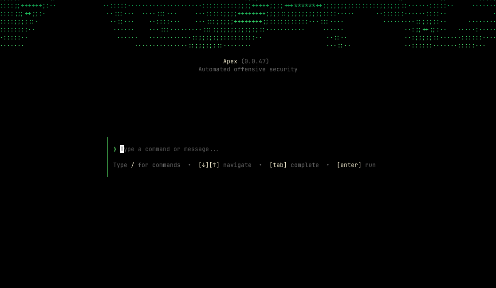

# Apex

  

  
  
  

> ⭐ **330 stars** | 🔗 [github.com/pensarai/apex](https://github.com/pensarai/apex)

## What is Apex?

**Apex** is an AI-powered offensive security testing tool that uses autonomous agents to conduct security assessments directly from your terminal. Built by **Pensar AI**, it provides a streamlined TUI (Terminal User Interface) for running AI-driven penetration tests.

## What is it for?

Apex brings **AI-powered offensive security** to the command line:

- **Terminal-based pentesting** — Run AI-driven security tests from a sleek TUI
- **Autonomous agents** — AI agents plan and execute security assessments independently
- **Offensive security focus** — Purpose-built for attack simulation and vulnerability discovery
- **Developer-friendly** — Designed for security-conscious developers who prefer the terminal
- **Multi-LLM support** — Works with Anthropic, vLLM, and other LLM providers

## How Does It Work?

1. **Launch** — Start Apex from your terminal with a target definition
2. **Agent Initialization** — An autonomous AI agent is spawned with offensive security capabilities
3. **Target Analysis** — The agent analyzes the target, identifying the attack surface and potential entry points
4. **Testing Execution** — The agent executes security tests, running tools and techniques autonomously
5. **Results** — Findings are presented in the terminal UI with details and remediation guidance

## Key Features

| Feature | Description |
|---|---|
| 🖥️ Terminal UI | Beautiful TUI for a smooth terminal-based pentesting experience |
| 🤖 Autonomous Agents | AI agents independently plan and execute security tests |
| ⚔️ Offensive Focus | Purpose-built for attack simulation and security testing |
| 🔌 Multi-LLM | Supports Anthropic, vLLM, and other providers |
| 🧰 TypeScript | Built with TypeScript and the AI SDK for reliability |
| ⚡ Lightweight | Minimal setup, designed for quick security assessments |

## Use Cases

- **Developers** — Quick security checks from the terminal during development
- **Penetration Testers** — AI-augmented testing for routine assessments
- **Security Enthusiasts** — Explore offensive security with AI assistance
- **Bug Bounty Hunters** — Rapid target analysis and vulnerability discovery
- **Red Teams** — Lightweight AI agent for initial reconnaissance and testing

## Topics

`agents` `ai` `ai-sdk` `anthropic` `cybersecurity` `offensive-security` `pentesting` `tui` `typescript`

---

📦 **License:** Apache-2.0  
🔗 **Repository:** [https://github.com/pensarai/apex](https://github.com/pensarai/apex)
