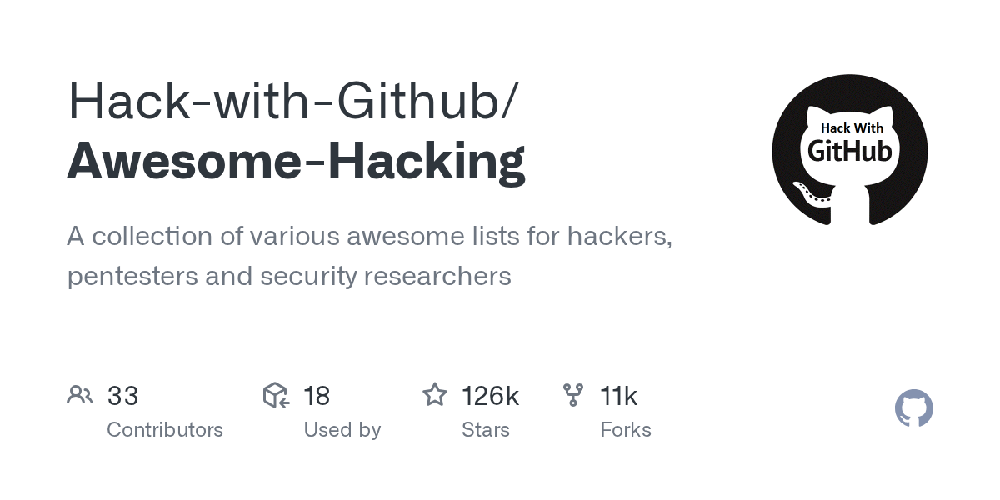

# Awesome Hacking

  

  
  
  

> ⭐ **126,356 stars** | 🔗 [github.com/Hack-with-Github/Awesome-Hacking](https://github.com/Hack-with-Github/Awesome-Hacking)

## What is Awesome Hacking?

**Awesome Hacking** is an extensive curated collection of awesome lists, tools, and resources for hackers, penetration testers, and security researchers. With over 126,000 stars, it is one of the most starred security repositories on GitHub and serves as the ultimate gateway into the world of cybersecurity.

## What is it for?

Awesome Hacking is a **comprehensive directory of cybersecurity resources**:

- **Curated tool lists** — Links to the best tools for every security discipline
- **Learning resources** — Courses, books, tutorials, and CTF platforms for learning security
- **Category organization** — Resources organized by specialty (web hacking, reverse engineering, forensics, etc.)
- **Community-maintained** — Continuously updated by the global security community
- **Starting point** — The definitive entry point for anyone entering cybersecurity

## What Does It Cover?

Awesome Hacking aggregates resources across **all cybersecurity disciplines**:

| Category | Description |
|---|---|
| 🌐 Web Hacking | Tools and resources for web application security testing |
| 🔄 Reverse Engineering | Disassemblers, debuggers, and RE methodologies |
| 🐛 Bug Bounty | Platforms, tools, and guides for bug bounty hunting |
| 🧅 OSINT | Open Source Intelligence gathering tools and techniques |
| 📡 Network Security | Network analysis, packet capture, and IDS/IPS tools |
| 🔑 Cryptography | Encryption tools, cryptanalysis, and crypto challenges |
| 📱 Mobile Security | Android and iOS security testing tools and guides |
| 🧊 Malware Analysis | Sandboxes, analysis tools, and malware samples |
| 🏳️ CTF | Capture The Flag platforms, tools, and writeups |
| 🕵️ Forensics | Digital forensics tools and investigation methodologies |
| ☁️ Cloud Security | Cloud-specific security tools and best practices |
| 🔒 Penetration Testing | Complete pentesting toolkits and methodologies |

## How to Use It

1. **Browse Categories** — Navigate to the category relevant to your interest (web hacking, forensics, etc.)
2. **Explore Lists** — Each category links to dedicated "awesome lists" with detailed tool descriptions
3. **Discover Tools** — Find the right tool for your specific use case
4. **Learn** — Use the learning resources, tutorials, and CTF platforms to build your skills
5. **Contribute** — Submit PRs to add new resources and keep lists up to date

## Why It Matters

- **126,000+ stars** — The most popular security resource collection on GitHub
- **Comprehensive** — Covers every cybersecurity discipline in one place
- **Community-driven** — Continuously updated by thousands of security professionals
- **Free & open** — All resources are freely accessible
- **Gateway** — The single best starting point for cybersecurity learning and tool discovery

## Topics

`awesome` `hacking` `security` `penetration-testing` `bug-bounty` `reverse-engineering` `fuzzing` `android`

---

📦 **License:** CC0-1.0  
🔗 **Repository:** [https://github.com/Hack-with-Github/Awesome-Hacking](https://github.com/Hack-with-Github/Awesome-Hacking)
