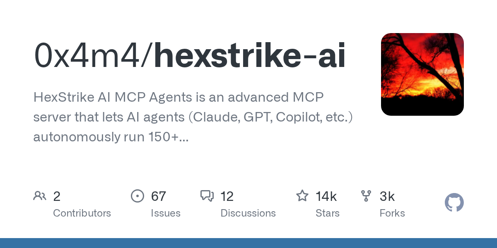

# HexStrike AI

  

  
  
  

> ⭐ **13,849 stars** | 🔗 [github.com/0x4m4/hexstrike-ai](https://github.com/0x4m4/hexstrike-ai)

## What is HexStrike AI?

**HexStrike AI** is an advanced MCP (Model Context Protocol) server that enables AI agents (Claude, GPT, Copilot, etc.) to autonomously run **150+ cybersecurity tools** for automated pentesting, vulnerability discovery, bug bounty automation, and security research. It bridges the gap between LLMs and real-world offensive security capabilities.

## What is it for?

HexStrike AI turns your AI coding agent into a **cybersecurity powerhouse**:

- **MCP-based integration** — Seamlessly connect AI agents to 150+ cybersecurity tools
- **Automated pentesting** — Let AI agents autonomously execute penetration testing workflows
- **Bug bounty automation** — Automate reconnaissance, scanning, and exploitation for bug bounty programs
- **Security research** — Use AI agents to explore attack surfaces and test security hypotheses
- **Tool orchestration** — AI agents intelligently chain tools together for complex security tasks

## How Does It Work?

1. **MCP Server Setup** — Install HexStrike AI as an MCP server and configure it with your AI agent (Claude Code, Copilot, etc.)
2. **Tool Discovery** — The AI agent discovers 150+ available cybersecurity tools through the MCP protocol
3. **Autonomous Planning** — The agent analyzes targets and plans which tools to use and in what order
4. **Tool Execution** — Tools are executed through the MCP server with the AI agent interpreting results in real-time
5. **Chained Operations** — The agent chains tool outputs together (e.g., subdomain discovery → port scanning → vulnerability testing)

## Key Features

| Feature | Description |
|---|---|
| 🔌 MCP Native | Built as an MCP server for seamless AI agent integration |
| 🧰 150+ Tools | Extensive library of cybersecurity tools accessible to AI agents |
| 🤖 Multi-Agent | Works with Claude, GPT, Copilot, and other MCP-compatible agents |
| ⛓️ Tool Chaining | AI agents can intelligently chain tools for complex workflows |
| 🎯 Offensive Security | Covers recon, scanning, exploitation, and post-exploitation |
| 🐧 Kali Integration | Leverages tools commonly found in Kali Linux |

## Use Cases

- **Penetration Testers** — Augment manual testing with AI-driven tool automation
- **Bug Bounty Hunters** — Automate large-scale reconnaissance and vulnerability discovery
- **Security Researchers** — Use AI agents to explore new attack vectors and test hypotheses
- **Red Teams** — Scale offensive operations with AI-orchestrated tool chains
- **AI Agent Developers** — Add cybersecurity capabilities to MCP-compatible AI agents

## Topics

`ai-agents` `ai-cybersecurity` `ai-hacking` `ai-penetration-testing` `mcp` `mcp-server` `mcp-tools` `kali-linux` `pentesting` `pentesting-tools`

---

📦 **License:** MIT  
🔗 **Repository:** [https://github.com/0x4m4/hexstrike-ai](https://github.com/0x4m4/hexstrike-ai)
