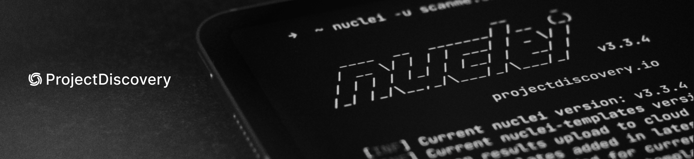

# Nuclei

<p align="center">
  
</p>

<p align="center">
  <a href="https://github.com/projectdiscovery/nuclei">
    
  </a>
  <a href="https://github.com/projectdiscovery/nuclei/blob/main/LICENSE.md">
    
  </a>
  <a href="https://github.com/projectdiscovery/nuclei">
    
  </a>
</p>

> ⭐ **33,226 stars** | 🔗 [github.com/projectdiscovery/nuclei](https://github.com/projectdiscovery/nuclei)

## What is Nuclei?

**Nuclei** is a fast, customizable vulnerability scanner built by **ProjectDiscovery**. Powered by a global security community, Nuclei uses a simple YAML-based DSL to define scanning templates, enabling security researchers and engineers to collaboratively detect trending vulnerabilities across the internet.

## What is it for?

Nuclei is designed for **vulnerability discovery at scale**. It allows you to:

- **Scan for known CVEs** across web applications, APIs, networks, DNS, and cloud configurations
- **Detect misconfigurations** in exposed services and applications
- **Run custom security checks** using community or private YAML templates
- **Automate reconnaissance** for bug bounty programs and red team engagements
- **Identify subdomain takeovers**, exposed panels, default credentials, and more

## How Does It Work?

1. **Template Selection** — Choose from 8,000+ community templates or write custom ones using Nuclei's YAML DSL
2. **Target Input** — Provide URLs, IPs, CIDR ranges, or pipe output from other tools (subfinder, httpx, etc.)
3. **Parallel Scanning** — Nuclei sends crafted requests based on template logic and analyzes responses for vulnerability indicators
4. **Matching Engine** — Responses are matched against template-defined conditions (status codes, headers, body content, regex, etc.)
5. **Reporting** — Results are output with severity levels and can be exported to JSON, SARIF, Markdown, or integrated with notification systems

```bash
# Scan a target with all templates
nuclei -u https://target.com

# Scan with specific templates
nuclei -u https://target.com -t cves/

# Scan multiple targets from a file
nuclei -l targets.txt -t exposures/
```

## Key Features

| Feature | Description |
|---|---|
| 📝 YAML Templates | Simple DSL for defining vulnerability checks — no coding required |
| 🌍 Community Driven | 8,000+ templates maintained by the global security community |
| ⚡ High Performance | Massively parallel scanning with rate limiting and retries |
| 🎯 Multi-Protocol | HTTP, DNS, TCP, SSL, WebSocket, and more |
| 🔄 CI/CD Integration | Use in pipelines for continuous vulnerability assessment |
| 🛠️ Extensible | Write custom templates for proprietary vulnerability checks |

## Use Cases

- **Bug Bounty Hunters** — Automate large-scale vulnerability scanning across multiple targets
- **Security Teams** — Continuously monitor external attack surfaces
- **Red Teams** — Quickly identify exploitable vulnerabilities during engagements
- **DevSecOps** — Integrate into CI/CD for automated security regression testing
- **Threat Intelligence** — Rapidly check for trending CVEs across your infrastructure

## Topics

`vulnerability-scanner` `cve-scanner` `dast` `security-scanner` `subdomain-takeover` `attack-surface` `vulnerability-detection`

---

📦 **License:** MIT  
🔗 **Repository:** [https://github.com/projectdiscovery/nuclei](https://github.com/projectdiscovery/nuclei)
