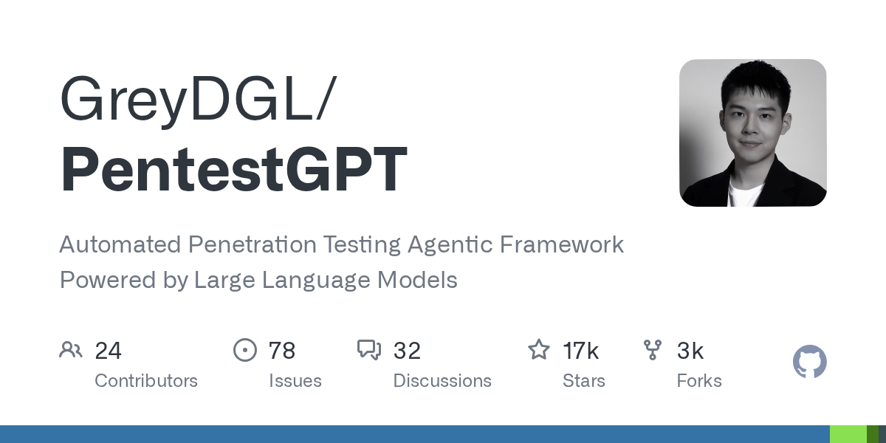

# PentestGPT

  

  
  
  

> ⭐ **16,570 stars** | 🔗 [github.com/greydgl/pentestgpt](https://github.com/greydgl/pentestgpt)

## What is PentestGPT?

**PentestGPT** is an automated penetration testing agentic framework powered by Large Language Models (LLMs). It acts as an AI-driven penetration testing assistant that helps guide and automate the entire pentesting lifecycle — from reconnaissance to exploitation to reporting.

## What is it for?

PentestGPT serves as an **LLM-powered penetration testing co-pilot**:

- **Guided penetration testing** — The LLM helps plan attack strategies and suggests next steps
- **Automated task execution** — Runs common pentesting tools and interprets their output
- **Context-aware analysis** — Maintains context throughout the engagement for intelligent decision-making
- **Learning assistant** — Helps less experienced testers understand vulnerabilities and attack techniques
- **Report generation** — Compiles findings into structured penetration testing reports

## How Does It Work?

1. **Session Initialization** — Start a PentestGPT session and define your target scope
2. **Reconnaissance Phase** — The LLM guides initial reconnaissance, suggesting tools and interpreting results (nmap, gobuster, etc.)
3. **Vulnerability Analysis** — Based on recon findings, the agent identifies potential vulnerabilities and prioritizes them
4. **Exploitation Guidance** — PentestGPT suggests exploitation techniques and helps craft payloads
5. **Iterative Testing** — The agent maintains a testing tree, tracking progress and suggesting next steps based on what's been discovered
6. **Reporting** — Findings are compiled into a structured report with evidence and remediation guidance

## Key Features

| Feature | Description |
|---|---|
| 🤖 LLM-Powered | Uses GPT and other LLMs for intelligent penetration testing guidance |
| 🌳 Testing Tree | Maintains a structured tree of testing progress and findings |
| 🔧 Tool Integration | Integrates with common pentesting tools (nmap, gobuster, sqlmap, etc.) |
| 📚 Context Memory | Maintains engagement context for coherent, multi-step testing |
| 📝 Auto Reporting | Generates structured penetration testing reports |
| 🎓 Educational | Explains techniques and reasoning, helping testers learn |

## Use Cases

- **Junior Pentesters** — Get AI-guided assistance during penetration tests
- **Security Students** — Learn penetration testing methodologies with AI guidance
- **Bug Bounty Hunters** — Accelerate the testing process with AI-driven suggestions
- **CTF Players** — Get hints and guidance during Capture The Flag competitions
- **Security Teams** — Augment human testers with AI assistance for routine tasks

## Topics

`large-language-models` `llm` `penetration-testing` `python` `ai-security`

---

📦 **License:** MIT  
🔗 **Repository:** [https://github.com/greydgl/pentestgpt](https://github.com/greydgl/pentestgpt)
