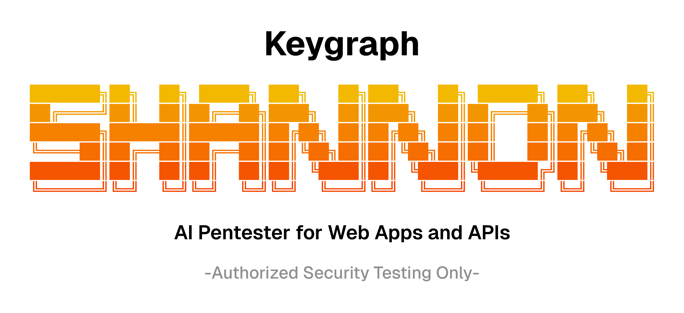

# Shannon

  

  
  
  

> ⭐ **52,227 stars** | 🔗 [github.com/KeygraphHQ/shannon](https://github.com/KeygraphHQ/shannon)

## What is Shannon?

**Shannon** is an AI-powered penetration tester for web applications and APIs, developed by **Keygraph**. It analyzes your source code, identifies attack vectors, and executes real exploits to prove vulnerabilities before they reach production. Named after Claude Shannon (the father of information theory), it brings intelligence-driven security testing to the development workflow.

## What is it for?

Shannon serves as an **automated offensive security tester** that goes beyond scanning:

- **Source code analysis** — Understands your application logic to find context-specific vulnerabilities
- **Real exploit execution** — Doesn't just flag potential issues; it proves them with actual exploits
- **API security testing** — Thoroughly tests REST, GraphQL, and other API endpoints
- **CI/CD integration** — Runs automated pen tests in your pipeline before deployment
- **SARIF output** — Produces standardized findings compatible with GitHub Code Scanning and other tools

## How Does It Work?

1. **Code Analysis** — Shannon ingests your source code and builds an understanding of the application's architecture, authentication flows, and data handling
2. **Attack Vector Identification** — Using AI, it identifies potential attack vectors specific to your application (not generic template-based scanning)
3. **Exploit Generation** — For each identified vector, Shannon crafts targeted exploits
4. **Exploit Execution** — It runs the exploits against your application to confirm vulnerabilities are real
5. **Reporting** — Proven vulnerabilities are documented with evidence, severity, and remediation guidance in SARIF format

## Key Features

| Feature | Description |
|---|---|
| 🧠 AI-Powered Analysis | Understands application logic, not just pattern matching |
| 💥 Real Exploits | Proves vulnerabilities with actual exploitation, not theoretical findings |
| 🌐 Web App & API Testing | Comprehensive testing for modern web applications and APIs |
| 🔄 CI/CD Native | Designed to run in pipelines (GitHub Actions, GitLab CI, etc.) |
| 📋 SARIF Output | Machine-readable output compatible with GitHub Code Scanning |
| 🏗️ OWASP Coverage | Tests for OWASP Top 10 and beyond |

## Use Cases

- **Development Teams** — Prove your application is secure before every release
- **AppSec Engineers** — Automate penetration testing for web apps and APIs
- **DevSecOps** — Integrate real exploit-based testing into CI/CD pipelines
- **Red Teams** — Use as a force multiplier for web application assessments
- **Security Auditors** — Generate evidence-based vulnerability reports

## Topics

`ai-penetration-testing` `ai-security` `api-security` `appsec` `ci-cd` `cybersecurity` `devsecops` `offensive-security` `owasp` `penetration-testing` `red-teaming` `sarif` `security-testing`

---

📦 **License:** AGPL-3.0  
🔗 **Repository:** [https://github.com/KeygraphHQ/shannon](https://github.com/KeygraphHQ/shannon)
