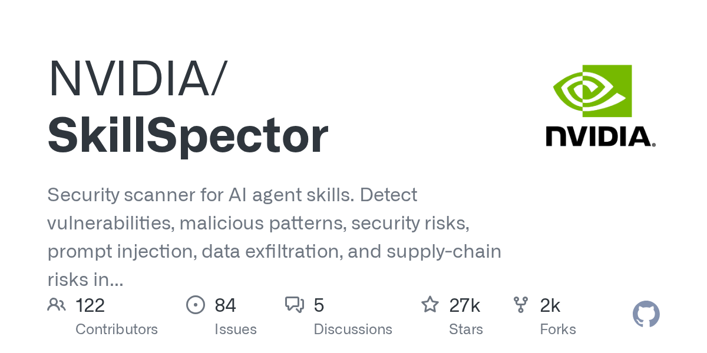

# SkillSpector

  

  
  
  

> ⭐ **27,414 stars** | 🔗 [github.com/NVIDIA/SkillSpector](https://github.com/NVIDIA/SkillSpector)

## What is SkillSpector?

**SkillSpector** is a security scanner for AI agent skills, developed by **NVIDIA**. It detects vulnerabilities, malicious patterns, security risks, prompt injection, data exfiltration, and supply-chain risks in Claude Code, Codex, and MCP skills **before you install them**. Think of it as an antivirus for AI agent plugins.

## What is it for?

As AI coding agents (Claude Code, Codex, Cursor, etc.) gain the ability to install third-party skills and MCP servers, **supply-chain security becomes critical**. SkillSpector provides:

- **Pre-installation scanning** — Analyze skills and MCP servers before they touch your system
- **Prompt injection detection** — Identify hidden instructions that could hijack your AI agent
- **Data exfiltration checks** — Detect skills that might secretly send your data to external servers
- **Malicious pattern recognition** — Flag suspicious code patterns in skill implementations
- **Supply-chain risk assessment** — Evaluate the trust level of skill sources and dependencies

## How Does It Work?

1. **Skill Input** — Point SkillSpector at a skill directory, MCP server config, or repository
2. **Static Analysis** — The scanner analyzes skill code for known malicious patterns, suspicious API calls, and dangerous permissions
3. **Prompt Analysis** — System prompts and instructions are analyzed for prompt injection, instruction override, and manipulation techniques
4. **Data Flow Analysis** — Network calls and data handling are traced to detect potential exfiltration paths
5. **Risk Report** — A comprehensive risk assessment is generated with severity ratings and specific concerns

## Key Features

| Feature | Description |
|---|---|
| 🛡️ Skill Scanning | Analyze AI agent skills and MCP servers before installation |
| 💉 Prompt Injection Detection | Identify hidden instructions in skill prompts |
| 📤 Data Exfiltration Detection | Flag skills that may secretly export your data |
| 🔗 Supply Chain Analysis | Assess trust and risk of skill sources and dependencies |
| 🤖 Multi-Agent Support | Supports Claude Code, Codex, and MCP ecosystems |
| ⚡ Pre-Installation | Scan before you install — prevention over detection |

## Use Cases

- **Developers Using AI Agents** — Verify skills are safe before installing them
- **Enterprise Security Teams** — Establish a vetting process for AI agent skills
- **AI Agent Ecosystem** — Build trust in the emerging agent skill marketplace
- **MCP Server Operators** — Audit MCP servers for security issues
- **Open Source Community** — Contribute to the safety of the AI agent ecosystem

## Topics

`agent-security` `agent-skills` `agentic-ai` `ai-security` `claude-code` `mcp` `prompt-injection` `security-scanner` `supply-chain-security`

---

📦 **License:** Apache-2.0  
🔗 **Repository:** [https://github.com/NVIDIA/SkillSpector](https://github.com/NVIDIA/SkillSpector)
